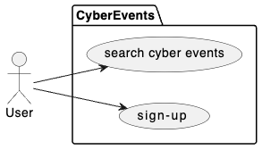
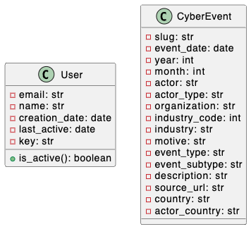

[](https://classroom.github.com/a/dp4lRfWe)
# Overview 

The Cyber Events API aims to serve as a public repository of cybersecurity events that have occurred globally. After registering an account, users have a one-time opportunity to obtain a private key required to access the API services. 

You are provided with a partially completed implementation of the web app for API registration, as well as the API itself. Your goal is to identify and assess vulnerabilities within the web app and API, and then make the necessary changes to remediate any vulnerabilities found.

# Requirements

* Users should be able to create an account with basic profile information, including email and name.
* The system should identify when each account was created and the last time the account used the API.
* The system should generate a unique access key for each user, which should be displayed to the user only once.
* Active users should be able to access the API services using their personal access key.
* Access to the API is restricted to active users with their personal access key. 
* The system should no longer allow user access to the API services if the account has been inactive for the last 6 months or more.
* Users should be able to filter cyber events using the API, which returns responses in JSON format.
* The API response should be limited to 10 cyber events per request.
* Users can use a pagination parameter to retrieve more events based on their query parameters.
* Once an account is deemed inactive, the user needs to either create a new account (with a different email) or contact customer service to reactivate their account.



# Data Model 

The dataset for this project was originally obtained from [Cyber Events Database Home](https://cissm.umd.edu/research-impact/publications/cyber-events-database-home). It has been exported to you in a CSV format and is available at [data/cyber_events.csv](data/cyber_events.csv). The dataset consists of 13,841 cyber events that occurred globally over the past 10 years.



# Database Setup

You are required to use postgres in this project. Use **docker pull postgres** to download the public postgres image, if you haven't yet.  The database must be saved in a folder named **instance**. You should manually create that folder. The **instance** folder should then be mapped to the container's folder where postgres saves their (managed) databases. This can be achieved using **docker run**'s syntax below:  

```
docker run --rm --name postgres --publish 5432:5432 -e POSTGRES_USER=postgres -e POSTGRES_PASSWORD=135791 -v $(pwd)/instance:/var/lib/postgresql/data postgres
```

Once postgres is running, connect to it using **psql**: 

```
docker exec -it postgres psql -U postgres
```

Next, execute the statements in [src/cyber_events.sql](src/cyber_events.sql) to create the **cyber_events** database. 

Finally, run [src/init_db.py](src/init_db.py) to complete your database setup by populating the **cyber_events** table. 

# Trust Model 

* Users must provide valid profile information to create an account, including basic email validation and CAPTCHA to prevent automated account creation.
* Users who have been inactive for at least 6 months should not be able to access the API services.
* Users should be limited to sending no more than 5 requests per minute.
* Users need to provide their personal private keys whenever using the API.
* The system must log all user activities.

# Threat Model 

Use the format below to document all of the vulnerabilities found in the shared prototype. At least five vulnerabilities must be reported in this section. 

## Number. Name of the Threat

* Affected Component: 
* Description: 
* Result: 
* Recommendation: 

# Implementation 

Review the code for the Cyber Events web app / API and address all of the threats that you found and documented.

# Testing 

Write at least one white- and one black-box testing in [tests/white_box_tests.py](tests/white_box_tests.py) and [tests/black_box_tests.py](tests/black_box_tests.py). 

Generate a coverage report in html. 

# Rubric 

```
+5 for each docummented threat to a total of +20 points 
+10 for each docummented threat addressed to a total of +50 points 
+10 for writing a white-box test case
+15 for writing a black-box test case
+5 for the test coverage report
```